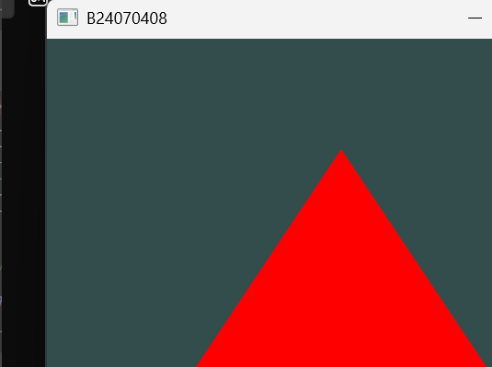

# 10. RenderObject 与三角形绘制

## 10.1 课堂函数

``` cpp
static void RenderObject(GLuint& shaderProgram, GLuint& vao)
{
    glUseProgram(shaderProgram);
    glBindVertexArray(vao);
    glDrawArrays(GL_TRIANGLES, 0, 3);
    glBindVertexArray(0);
}
```

老师将原先考虑的 `RenderScreen` 改为 `RenderObject`，并把 VAO
作为参数传入。

## 10.2 每行的作用

### `glUseProgram(shaderProgram)`

指定本次绘制使用的 Shader Program。Program 在进入 Render Loop
前已经创建、编译并链接。

### `glBindVertexArray(vao)`

绑定已经配置好的 VAO，使 OpenGL 按其中记录的顶点属性配置读取顶点数据。

### `glDrawArrays(GL_TRIANGLES, 0, 3)`

发出绘制命令：

-   `GL_TRIANGLES`：按每三个顶点组成一个三角形的方式解释顶点。
-   `0`：从顶点序列的第 0 个顶点开始。
-   `3`：读取 3 个顶点。

当前数据只有三个顶点，所以绘制一个三角形。

### `glBindVertexArray(0)`

解除当前 VAO 绑定。

## 10.3 为什么将 VAO 作为参数传入

老师提到 VAO
如果是全局变量，函数可以直接访问，不一定非要作为参数传入。但显式传入
`vao`，能让函数的依赖关系更清楚，也方便以后复用和完成作业。

本课程以老师最后采用的写法为准：

``` cpp
RenderObject(shaderProgram, VAO);
```

不要为了个人偏好擅自把参数删掉或改变函数结构。

## 10.4 两条准备线与一次绘制

``` text
CreateShaderProgram() ──→ shaderProgram ──┐
                                          ├─→ RenderObject() → glDrawArrays()
CreateVertexBuffer() ───→ VAO / VBO ──────┘
```

两条线都在 Render Loop 之前准备完成；每一帧调用 `RenderObject()`
完成实际绘制。

## 10.5 运行结果

程序已经成功绘制出一个红色三角形，背景为深青灰色。



这是当前课程阶段的结果，不代表第一次作业的房子已经完成。房子的正式要求尚待老师公布。
