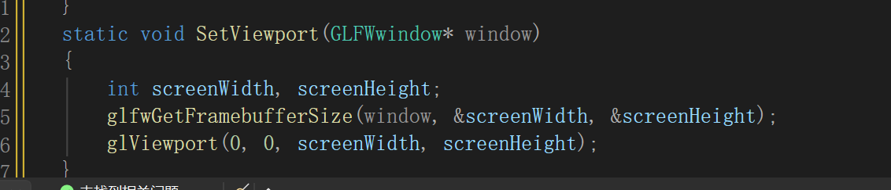

# 11. Viewport 与窗口尺寸

## 11.1 课堂函数

``` cpp
static void SetViewport(GLFWwindow* window)
{
    int screenWidth, screenHeight;
    glfwGetFramebufferSize(window, &screenWidth, &screenHeight);
    glViewport(0, 0, screenWidth, screenHeight);
}
```

## 11.2 `glfwGetFramebufferSize()`

``` cpp
glfwGetFramebufferSize(window, &screenWidth, &screenHeight);
```

获取窗口对应的 framebuffer
尺寸，并将宽度和高度写入变量。渲染时应关注实际 framebuffer
尺寸，而不是不加区分地把所有窗口尺寸都当成相同概念。

## 11.3 `glViewport()`

``` cpp
glViewport(0, 0, screenWidth, screenHeight);
```

设置 OpenGL 视口：左下角起点为 `(0, 0)`，宽度和高度分别由 framebuffer
的宽、高决定。它影响标准化设备坐标映射到窗口区域的方式。

## 11.4 放在 Render Loop 内还是外？

课堂讨论了 `SetViewport(window)` 的位置：

-   当前课堂代码将它放在 `while` 循环内部。
-   如果每帧都执行，而窗口尺寸没有变化，就会重复设置，存在不必要的调用开销。
-   但视口设置的位置要结合需求；窗口尺寸可能变化时，需要确保视口尺寸及时更新。

老师尚未要求改用其他方案，因此本课程记录保留课堂当前写法，不擅自替换为回调机制。

## 11.5 代码截图


