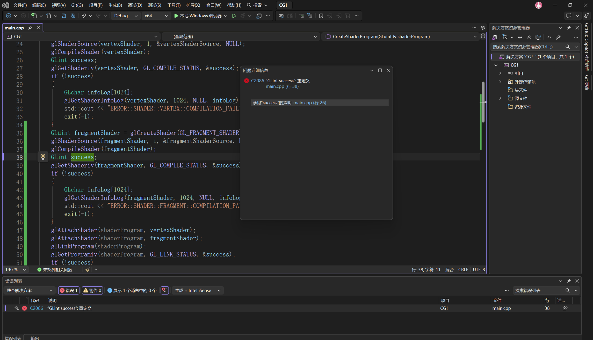

# 12. 课堂错误记录与排查

本文件记录实际遇到或明确发现的错误。对原因尚不能确定的情况，明确标注为"待核实"，不把推测写成已确认结论。

## 12.1 C2086：`GLint success` 重定义

**现象：** Visual Studio 报告 `C2086: “GLint success”: 重定义`。

**原因：** `CreateShaderProgram()` 中已经声明了
`GLint success;`，在同一作用域处理 Fragment Shader 时又声明一次。

**处理：** 保留一个 `GLint success;` 声明，在后续的状态查询中复用变量。

**记忆点：**
变量声明与变量赋值/使用不同；同一作用域内不能重复定义同名局部变量。



## 12.2 链接错误分支调用错日志函数

**现象：** 代码已经进入 Shader Program 链接错误处理，但日志调用最初仍是
`glGetShaderInfoLog()`。

**原因：** 混淆了 Shader 对象与 Program 对象的日志接口。

**正确对应：**

``` cpp
// 单个 Shader 编译失败
glGetShaderInfoLog(vertexShader, 1024, NULL, infoLog);

// Shader Program 链接失败
glGetProgramInfoLog(shaderProgram, 1024, NULL, infoLog);
```

**处理：** 链接失败分支改为
`glGetProgramInfoLog()`。不要只修改错误提示文字而遗漏 API 函数本身。

## 12.3 C1083：找不到 `GL/glew.h`

**现象：** 编译输出出现无法打开包含文件 `gl/glew.h` 的错误，随后 Visual
Studio 又提示找不到生成的 `.exe`。

**能确认的原因范围：**
编译器当前没有成功解析该头文件。由于编译失败，目标可执行文件没有生成，因此后续"找不到
exe"可能是编译失败的连带结果，不能先把它当成独立的调试器故障。

**排查顺序：**

1.  确认实际文件存在于第三方库的 `Include/GL/glew.h`。
2.  在 Visual Studio 的逻辑视图中打开正确项目的属性。
3.  检查 C/C++ 的附加包含目录是否仍指向正确的 `Include`。
4.  核对相对路径相对于 `.vcxproj`
    所在位置是否正确，以及移动/重命名后目录层级是否保持。
5.  重新生成，先确认编译成功，再启动调试。

**尚未保存的细节：** 当前记录无法确认当时最终是哪一项配置导致
C1083，也不把某一种修复方式写成已完成的事实。

## 12.4 "请选择有效的启动项"与"找不到 exe"

遇到调试启动失败时，先看"输出"窗口的生成结果：

-   如果生成阶段已经报错，优先解决第一个编译错误。
-   如果生成成功但仍无法启动，再检查启动项目、活动配置、平台和目标程序路径。

不要在编译失败时反复调整调试器设置，忽略真正的首个错误。

## 12.5 Visual Studio 属性窗口打不开

**现象：** 一开始无法按预期打开项目属性。

**已确认的处理：**
向老师确认后，切换为解决方案的逻辑视图，再从正确的项目层级打开属性。

这说明需要区分磁盘文件夹视图与解决方案/项目逻辑视图。

## 12.6 `SetViewport()` 的位置

这不是编译错误，而是结构与效率上的讨论。当前课堂版本在 Render Loop
内调用；老师指出若每帧都执行可能产生重复开销，但具体位置要看需求。当前记录不把它擅自改成其他实现。

## 12.7 课堂错误记录原则

``` text
记录报错原文
→ 找到最先发生的错误
→ 判断是 C++ 编译、Shader 编译、Program 链接还是运行/调试阶段
→ 记录原因（已证实 / 待核实）
→ 记录修改
→ 重新生成与运行
→ 记录验证结果
```
