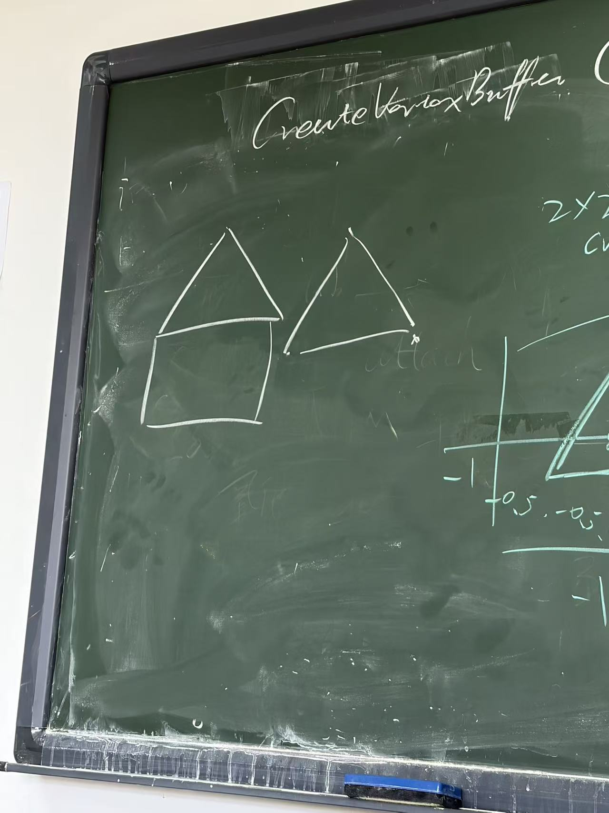

# 13. 本节课复习清单与作业预告

## 13.1 上课前 5 分钟自测

尝试不看笔记回答：

1.  为什么必须先创建并设置当前 OpenGL Context，再初始化 GLEW？
2.  `CreateShaderProgram()` 和 `CreateVertexBuffer()` 分别负责什么？
3.  Vertex Shader 的 `position` 为什么是 `vec3`，但 `gl_Position` 是
    `vec4`？
4.  VBO 和 VAO 分别保存什么？
5.  `glVertexAttribPointer(0, 3, GL_FLOAT, GL_FALSE, 3 * sizeof(GLfloat), (GLvoid*)0)`
    中每个参数是什么意思？
6.  为什么链接失败时使用 `glGetProgramInfoLog()`，而不是
    `glGetShaderInfoLog()`？
7.  `glClearColor()` 与 `glClear()` 的区别是什么？
8.  `glfwSwapBuffers()` 与 `glfwPollEvents()` 分别负责什么？
9.  为什么 `CreateShaderProgram()` 应放在 Render Loop 之前？
10. `glDrawArrays(GL_TRIANGLES, 0, 3)` 的三个参数分别表示什么？

## 13.2 必须掌握的代码顺序

``` text
初始化 GLFW
→ 设置版本与 Profile
→ 创建窗口
→ 设置当前 Context
→ 初始化 GLEW
→ CreateVertexBuffer()
→ glCreateProgram()
→ CreateShaderProgram(shaderProgram)
→ while Render Loop
    → SetViewport(window)
    → glClearColor()
    → glClear()
    → RenderObject(shaderProgram, VAO)
    → glfwSwapBuffers()
    → glfwPollEvents()
→ glfwTerminate()
```

以上顺序按课堂当前代码整理。若老师后续修改顺序，以老师的最新要求为准。

## 13.3 第一次作业预告：画一个房子

老师预告的图形由以下两部分构成：

-   上方：一个三角形。
-   下方：一个正方形。



### 当前已知

-   作业目标是绘制"屋顶为三角形、主体为正方形"的房子。
-   目前只完成了单个红色三角形的基础绘制。
-   老师尚未公布房子的具体实现要求。

### 当前未知，不能提前假定

-   是否指定顶点坐标、尺寸与颜色。
-   是否要求复用一个 VAO/VBO。
-   是否指定 `glDrawArrays()` 的图元、顶点数量或调用次数。
-   是否需要使用特定函数结构。
-   最终提交文件与截图要求。

**执行原则：等老师公布正式要求后，逐条核对要求，沿用老师课堂代码结构完成；不擅自换用其他方法。**

## 13.4 下一节课记录栏

-   新知识点：
-   老师明确强调的规范：
-   新增或修改的函数：
-   本次遇到的报错：
-   报错原因与处理：
-   运行结果：
-   仍需向老师确认的问题：
